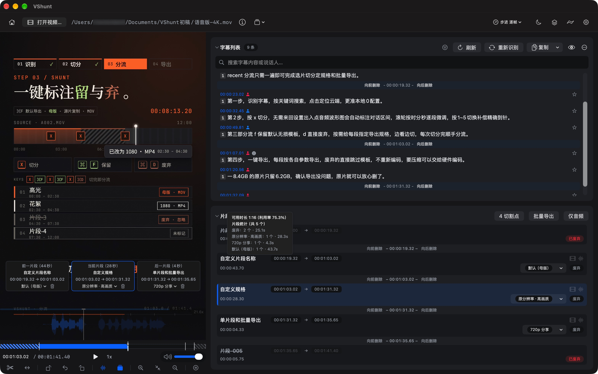
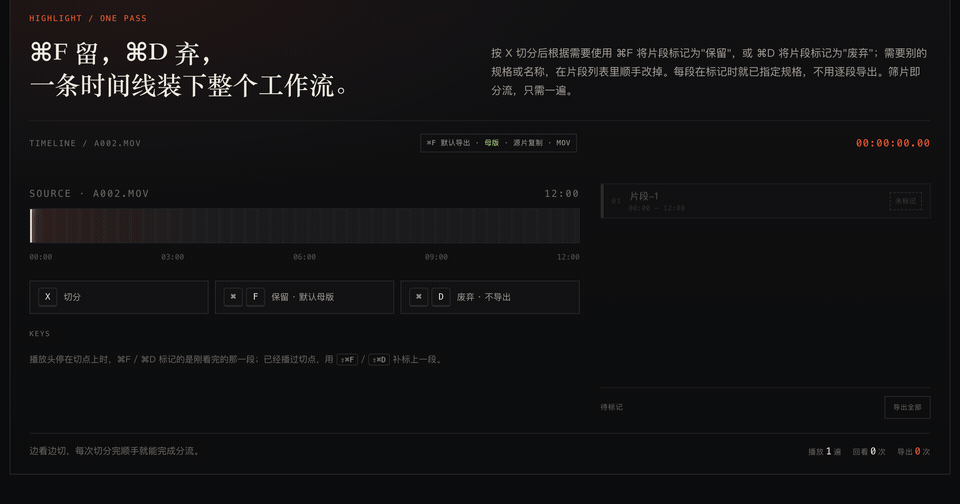
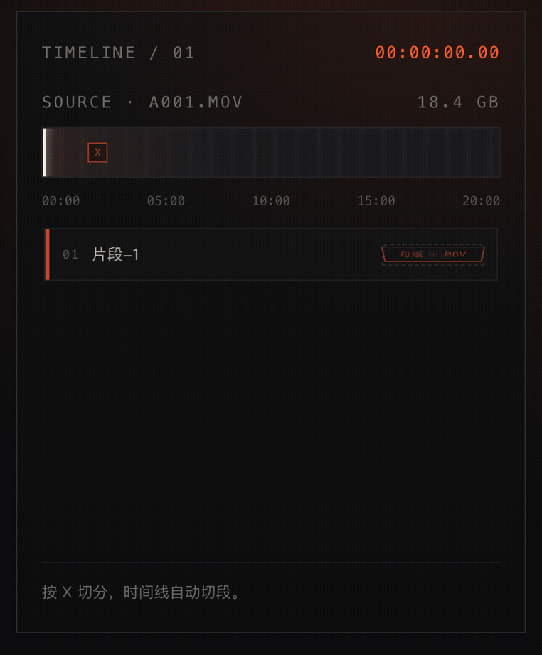
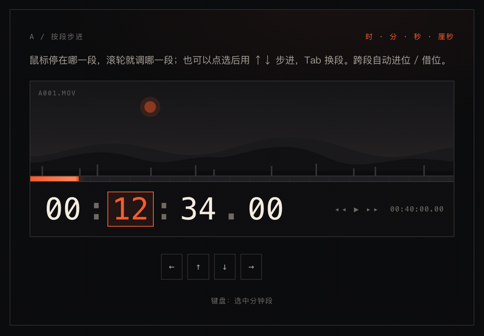
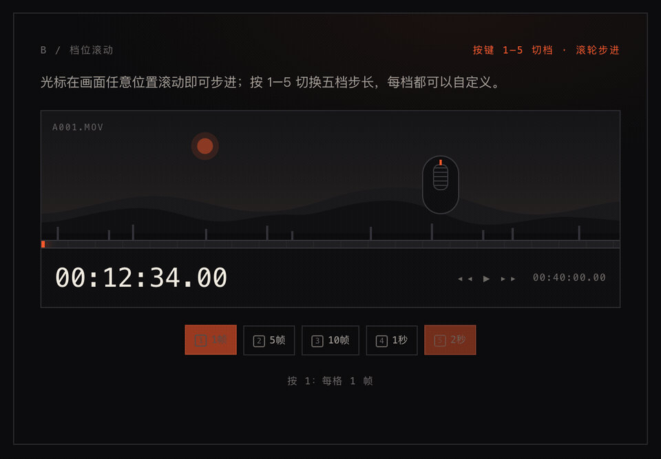
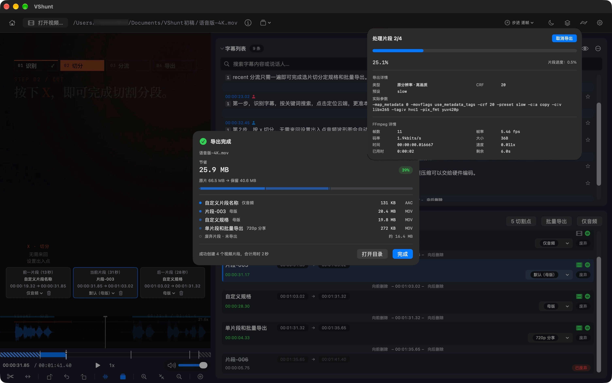
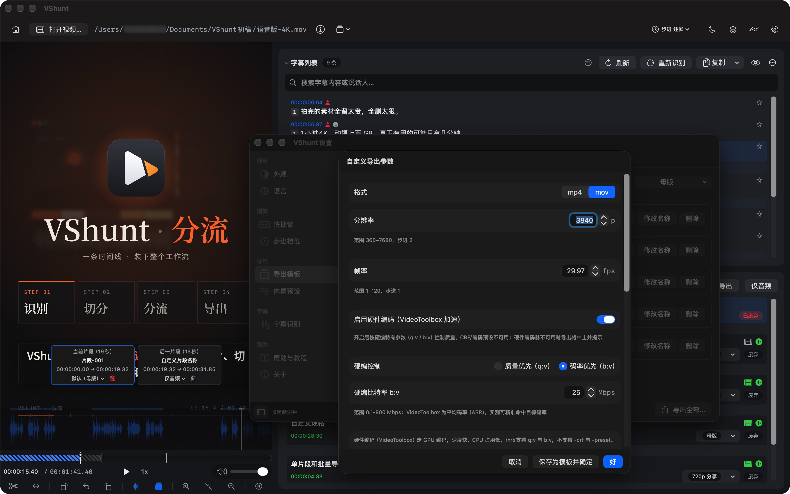

# VShunt — A storage lifesaver, and not only for independent creators

[简体中文](README.md) | **English**

> VShunt · a footage router — you don't have to keep it all, and you don't have to delete it all.

VShunt is a native rough-cut tool for creators with piles of 4K / Log footage and a nearly full drive, available for macOS and Windows: watch and cut as you go, give each segment its own export spec, and skip per-segment timelines and per-segment exports — one timeline carries the whole workflow. Both builds are native, with no embedded browser engine, and work out of the box.

---

  

## The problem

Footage only grows: an hour of 4K can run to a hundred gigabytes. Keep everything and storage costs keep climbing; delete everything and you risk losing something you need later. The bottleneck is usually not how fast you can cut — it is that the footage was never sorted by value.

General-purpose editors can cut and export, but selecting clips, marking in and out points, and configuring export settings for every segment are separate chores. You cannot select, cut, route and export on a single timeline, so multiple segments mean multiple rounds — and hand-written ffmpeg commands mean assembling parameters per segment.

VShunt collapses that into one pass: watch, cut and route along a single timeline, with each segment's destination and format decided the moment it is created, then export everything at once. VShunt never deletes your source files — cleanup is always yours to do.

## Workflow

1. **Identify** — for talking-head footage, transcribe first and judge content by the text, with keyword search and jump-to-match.
2. **Cut** — press `X` once to split at the playhead; no separate in/out marking. Subtitle and waveform views let cuts land exactly on the pause between sentences.
3. **Route** — mark as you watch: `⌘F` keeps the segment (an original master by default), `⌘D` discards it. Change format or name in the segment list when needed. Destinations include stream copy (lossless, very fast), scene presets, custom specs, audio only, or discard.
4. **Export** — export every segment in one batch with its own parameters, or export a single segment on its own.

**Mark as you watch** — tagging, renaming and changing specs all happen while screening, with no stopping to scroll back or start another pass.

  

**Screening is routing** — each segment's spec is decided when it is marked, and everything exports in one batch; no per-segment timelines, no per-segment exports, plus a volume tally of what you keep and what you drop.

  

## Features

- **Lossless cutting** — masters use stream copy, with no re-encode: identical quality, extremely fast export.
- **Per-segment specs** — set container (MP4 / MOV), resolution, frame rate, rate control (CRF / constant bitrate), encoding speed, hardware acceleration and metadata retention per segment. Audio is copied from the source. Codec follows the source: H.264 in, H.264 out; HEVC in, HEVC out.
- **Presets and templates** — six built-in presets (source-resolution high quality / smaller file, 4K, 1080p, 720p, 480p); save tuned settings as reusable templates and import or export them as JSON.
- **Arbitrary ffmpeg arguments** — append custom arguments in advanced options, with a command preview before export.
- **Timeline and waveform** — Canvas-drawn timeline, `Cmd + scroll` to zoom, playhead follow, with subtitle speech regions drawn onto the waveform.
- **Frame-accurate stepping** — the time field steps by hour, minute, second and centisecond: scroll over the segment under the cursor, or select it and use `↑` `↓` with `Tab` to switch fields, carrying and borrowing across units. Scrolling on the video steps by one of five configurable amounts.
- **Two subtitle backends** — Doubao cloud ASR (the engine behind Jianying, more accurate, speaker separation, emotion and other extended fields) or on-device system recognition (Apple Speech on macOS, system speech recognition on Windows; no setup, audio never leaves the machine). SRT / VTT / JSON can also be imported, with validation and a summary of what the file carries beforehand — or export the audio and a result template to your own tooling.
- **Batch processing** — multi-select files in a folder to generate proxies or transcribe subtitles; a serial queue runs items one by one, and a single failure does not block the rest.
- **Native experience** — customizable shortcuts, light and dark appearance, five UI languages (Simplified Chinese / English / Japanese / Korean / Russian), onboarding and a separate tutorial window, and long tasks that can move to the background.

## Precision control

Precision does not come from zooming the timeline. Screening needs fast browsing, while cutting needs an exact pause. In VShunt you decide how far each step goes: the time field steps by hour, minute, second and centisecond, and scrolling on the video steps by one of five configurable amounts — mouse and keyboard each have their equivalent.

**Step by segment** — scroll over whichever segment the cursor is on; after selecting a segment, `↑` `↓` step and `Tab` switches fields, carrying and borrowing across units.

  

**Step by wheel** — with the cursor anywhere on the video, the wheel steps; press `1`–`5` to switch between five step sizes, each of which can be named and set in frames or seconds.

  

## Export

Every segment carries its own export parameters, and every field is customizable.

**Readable progress, estimable time remaining** — the export window shows the actual ffmpeg command, frame rate, bitrate, elapsed time and remaining time, so even long jobs tell you how much longer to wait.

  

**Tune every field, or save the combination** — container, resolution, frame rate, rate control, encoding speed, hardware encoding and metadata are set separately; you can append arbitrary ffmpeg arguments with a full command preview, and save a tuned combination as a template to reuse across segments.

  

## Requirements

| Item | Requirement |
|---|---|
| System | macOS 26.0 or later; Windows 10 / 11 |
| Chip | Apple Silicon (M1 or later) on macOS; x64 on Windows |
| Installer | macOS: DMG, about 75 MB; Windows: Setup installer |
| Languages | Simplified Chinese / English / Japanese / Korean / Russian |

## Installation

### macOS

1. Download the DMG from [GitHub Releases](https://github.com/timehijack/VShunt/releases), open it, and drag VShunt into Applications.
2. If macOS says the developer cannot be verified, open System Settings › Privacy & Security and click "Open Anyway". If it says the app is damaged, open Terminal.app, paste the command below and press Return: `xattr -dr com.apple.quarantine /Applications/VShunt.app`. Notarized builds open directly.
3. Drag in any mp4 / mov file and press `X` to start cutting.

**Uninstall**: move VShunt from Applications to the Trash. Project data stays next to each video in `vshunt-data/`; templates and settings live in `~/Library/Application Support/VShunt`, which you can remove for a complete cleanup.

### Windows

1. Download the Setup installer from [GitHub Releases](https://github.com/timehijack/VShunt/releases) and follow the prompts. It installs per user and needs no administrator rights.
2. Open VShunt, drag in any mp4 / mov file and press `X` to start cutting.

**Uninstall**: remove VShunt from Settings → Apps. Project data stays next to each video in `vshunt-data/`; templates and settings live in `%APPDATA%\VShunt`, which you can remove for a complete cleanup.

## Platform

Both builds are native, with playback and rendering bypassing any browser engine. The macOS build is Swift + SwiftUI + AVFoundation, with playback, timeline, waveform and shortcuts running directly on system frameworks. The Windows build is a separate Qt 6 + C++20 + QML + libmpv implementation, with shortcuts and interactions following Windows conventions.

## Open source

VShunt is currently distributed as a binary; the app source and development documentation are not public yet. The public repository [timehijack/VShunt](https://github.com/timehijack/VShunt) hosts the installers, the website content and the third-party sources required for GPL compliance. Source for both platforms is being prepared and will be published there after code review and privacy review are complete.

## Download

Get the latest release (macOS DMG / Windows Setup) from [GitHub Releases](https://github.com/timehijack/VShunt/releases).

## Default shortcuts

Most shortcuts can be changed in Settings. `⌘F` / `⌘D`, the `Shift` combinations, and `Space` / `Esc` are fixed.

| Key | Action |
|---|---|
| `X` | Add a cut point at the playhead |
| `S` | Remove a cut point; two-step move of a cut point |
| `Shift + S` | Move the nearest cut point to the playhead |
| `K` / `Space` | Play / pause |
| `J` / `L` | Rewind / fast-forward at the current step size |
| `Z` / `C` | Previous / next frame |
| `Q` / `E` | Previous / next segment |
| `F` | Open the quick panel for the current segment |
| `1` – `5` | Switch between five step sizes (frame to second level) |
| `Cmd + F` / `Cmd + D` | Mark the current segment for export / discard it |
| `Shift + Cmd + F` / `Shift + Cmd + D` | Mark the segment you just watched |
| `Shift + Z` | Zoom the timeline and waveform together |

## Privacy and network

- Playback, cutting and export all happen locally, with no relay service involved.
- Cloud transcription requires your own Doubao API key and OSS / TOS storage credentials. Credentials are stored only in the local app configuration and used only for the services you configure. With cloud transcription, only the audio is uploaded to your own object storage, and the remote audio object is deleted automatically once recognition finishes; the video file itself is never uploaded.
- If you prefer not to use the cloud, switch to on-device system recognition (Apple Speech on macOS, system speech recognition on Windows) and the audio never leaves your machine.
- VShunt only marks and exports. It never deletes source files.

## Third-party components and licenses

The app bundles ffmpeg 8.0.1 and the components below, built statically with a GPL configuration and invoked as a separate process (not linked into the app):

| Component | Version | License |
|---|---|---|
| FFmpeg | 8.0.1 | GPLv2+ |
| x264 | stable | GPLv2+ |
| x265 | 4.1 | GPLv2+ |
| LAME | 3.100 | LGPLv2.1 |
| libvpx | 1.15.0 | BSD-3-Clause |
| SVT-AV1 | 2.3.0 | BSD-3-Clause |

Component versions, build configurations and license texts ship with each release. The complete corresponding source and build scripts are available in the [GitHub Release (ffmpeg-8.0.1)](https://github.com/timehijack/VShunt/releases/tag/ffmpeg-8.0.1); the bundled `NOTICE.txt` contains the GPLv2 §3(b) written offer (contact: `timehijack@qq.com`).

This project's own code is released under the **GNU General Public License v3.0**; see [LICENSE](LICENSE) for the full terms.
