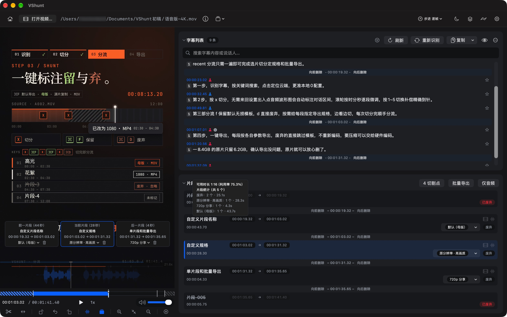
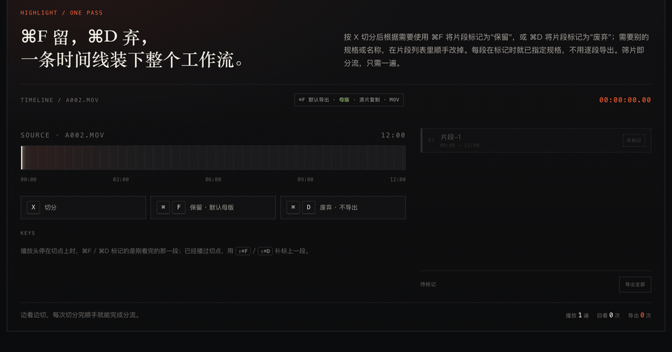
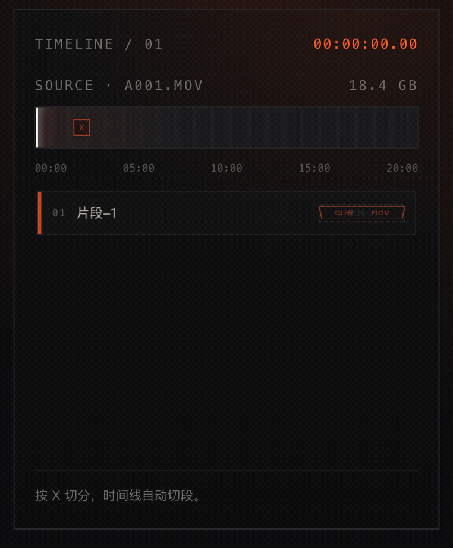
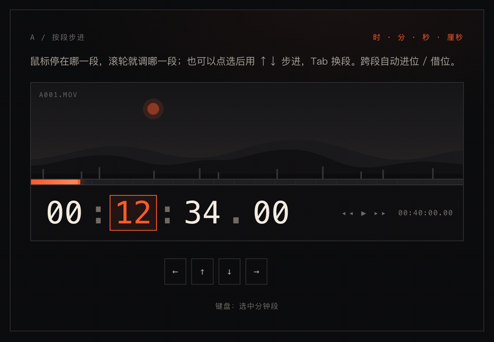
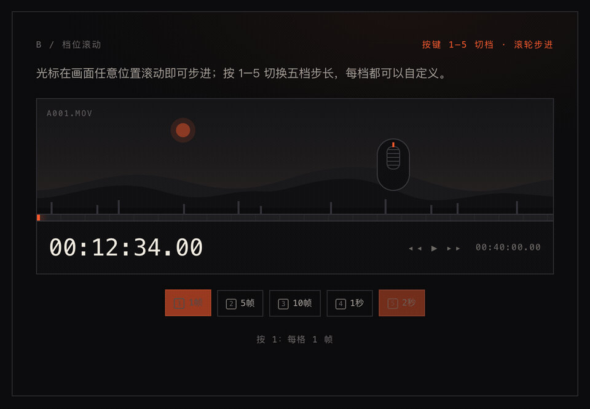
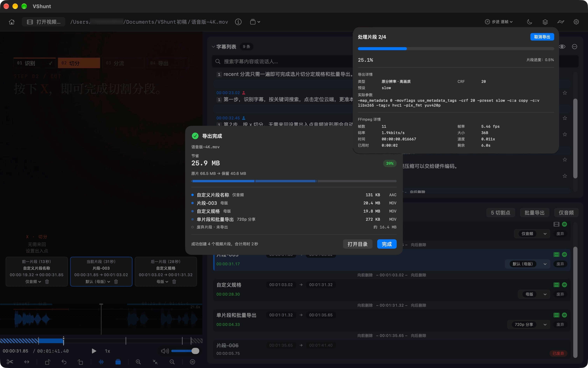
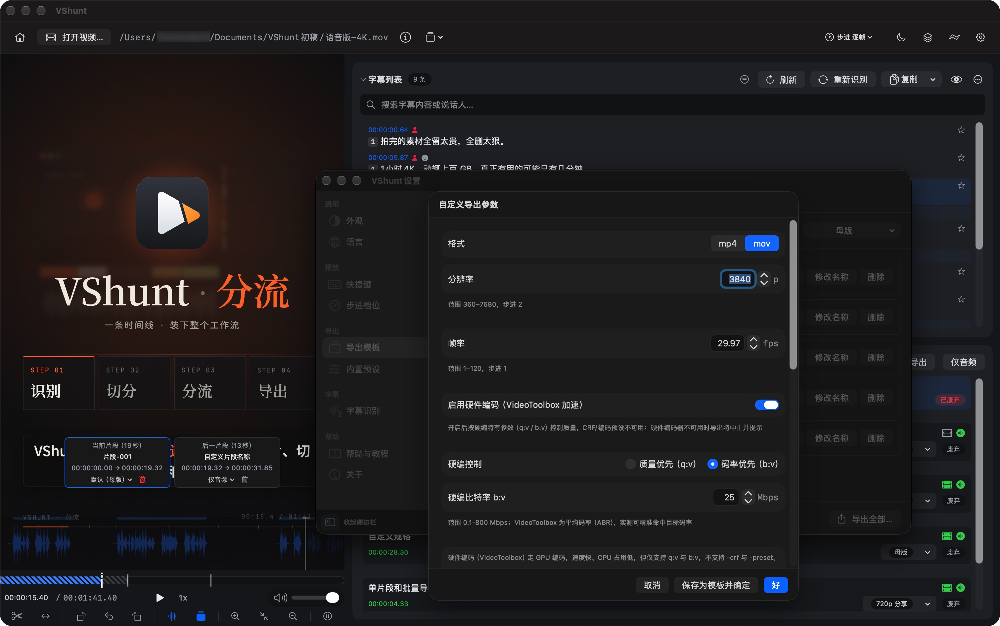

# VShunt · 分流 — 不只是自媒体人的存储救星

**简体中文** | [English](README.en.md)

> VShunt · 素材分流器 / 素材不用全留，也不用全删

VShunt 是为拍了一堆 4K / Log 素材、硬盘快满的创作者做的原生粗剪工具，macOS 与 Windows 双平台：边看边切，按需给每段指定导出规格，不用为每段另开时间线，也不用逐段导出——一条时间线装下整个工作流。两端都是原生实现，不套浏览器内核，下载即用。

*VShunt is a native lossless video cutting tool for macOS and Windows — sort footage by value, cut, transcode and batch-export in one pass.*

---

  

## 解决什么问题

素材会持续膨胀：一小时 4K 素材可能上百 GB。全留，存储成本一直涨；全删，又怕以后还要用。真正的问题往往不是「剪得不够快」，而是素材没有按价值分流。

传统软件当然也能剪辑和导出，但选片段、标入点出点、为每段单独设置导出参数都很繁琐，无法在一条时间线上一次完成选、剪、分、导——多个片段就得重复多轮；手写 ffmpeg 又要为每个片段拼参数。

VShunt 把这一整套压缩成一次操作：在一条时间线上边看边选、边切边分流，每段素材在切分时就标记保留或废弃，并指定导出规格，最后一次性导出。确认导出结果无误后，即可自行清理原片；VShunt 不会自动删除源文件，删除操作始终由你执行。

## 工作流

1. **识别** — 对话类素材先识别字幕，按文字快速判断内容价值，支持关键词搜索与跳转。
2. **切分** — 按 `X` 一次打点即完成分段，无需先设入点再设出点；配合字幕与波形，切口能精确落在一句话的停顿上，长素材也能快速切完。
3. **分流** — 边看边标记：`⌘F` 保留（默认原始母版）、`⌘D` 废弃；需要其他规格或名称时，可在片段列表中修改。每段可选的处理方式包括源片复制（无损、极快）、场景预设压缩、自定义规格、仅提取音频，或直接废弃忽略。
4. **导出** — 按既定参数一次性全部导出，也可单独导出某一段。

**边看边标记** — 标记、改名、换规格都在筛片过程中完成，不用停下来回翻或另起一轮。

  

**筛片即分流** — 每段在标记时已指定规格，最后统一批量导出；不用为每段另开时间线，也不用逐段导出，还能看到保留与废弃的体积清单。

  

## 功能

- **无损剪辑** — 母版走源片复制（stream copy），不重新编码，画质无损、导出极快。
- **按段设规格** — 每一段独立设置容器（MP4 / MOV）、分辨率、帧率、码率模式（CRF / 恒定码率）、编码速度、硬件加速与元数据保留；音频直接复制原音轨。编码跟随源：H.264 素材输出 H.264，HEVC 素材输出 HEVC。
- **预设与模板** — 内置原分辨率高画质 / 小体积、4K、1080p、720p、480p 六档场景预设，调好的参数可存为模板复用，支持 JSON 导入导出。
- **任意 ffmpeg 参数** — 高级选项可追加自定义参数，导出前提供命令预览。
- **时间线与波形联动** — Canvas 自绘时间线、`Cmd + 滚轮`缩放、播放头跟随，字幕语音区域直接标注在波形上。
- **横竖屏自适应** — 自动识别素材方向：预览区按横竖屏调整排布；导出 1080p 这类规格时，横屏按高度、竖屏按宽度等比缩放，画面不会被拉伸。
- **精确步进** — 时间框按段步进、画面按档位滚动，五档步长可自定义，跨段自动进位 / 借位。
- **字幕双后端** — 豆包云端识别（剪映同款更准确，可区分说话人，并提供情绪等扩展信息）、系统本机识别（macOS 为 Apple Speech，Windows 为系统语音识别；零配置、音频不出本机）；也支持导入 SRT / VTT / JSON，导入前会校验并列出字幕携带的信息，或导出音频与结果模板接入自己的识别工具。
- **批量处理** — 同目录多选文件，批量生成代理、批量识别字幕；串行队列逐项执行，单项失败不拖累整体。
- **原生体验** — 可自定义快捷键、深浅色外观、中 / 英 / 日 / 韩 / 俄五种界面语言，首次引导与独立教程窗口，长任务可转入后台。

## 精确控制

精确，不靠放大时间线。筛片时要能快速浏览，剪辑时要能精确停顿。在 VShunt 里，每一步走多远由你决定：时间框按时、分、秒、厘秒逐段步进，画面上滚动则按档位步进；鼠标和键盘都有对应的操作。

**按段步进** — 鼠标停在哪一段，滚轮就调哪一段；点选后也能用 `↑` `↓` 步进、`Tab` 换段，跨段自动进位或借位。

  

**按档位滚动** — 光标放在画面任意位置就能滚轮步进；按 `1`–`5` 切换五档步长，每档可以单独命名，步长按帧或秒设置。

  

## 导出

每一段都能独立设置导出参数，而且每一项都支持自定义。

**进度可感知，剩余时间可预估** — 导出窗口显示实际执行的 ffmpeg 命令、帧率、码率、已用时间与剩余时间，长任务也能判断还要等多久。

  

**逐项可调，也能存成模板** — 容器、分辨率、帧率、码率模式、编码速度、硬件编码与元数据分别设置，也能追加任意 ffmpeg 参数并预览完整命令；调好的组合可存为模板跨片段复用。

  

## 系统要求

| 项目 | 要求 |
|---|---|
| 系统 | macOS 26.0 及以上；Windows 10 / 11 |
| 芯片 | macOS 需 Apple Silicon（M1 及以上）；Windows 为 x64 |
| 安装包 | macOS：DMG，约 75 MB；Windows：Setup 安装包 |
| 语言 | 简体中文 / English / 日本語 / 한국어 / Русский |

## 安装

### macOS

1. 从 [GitHub Releases](https://github.com/timehijack/VShunt/releases) 下载 DMG，双击打开，把 VShunt 拖入「应用程序」。
2. 若提示「无法验证开发者」，到「系统设置 › 隐私与安全性」中点按「仍要打开」；若提示「已损坏，无法打开」，打开「终端.app」，粘贴并回车：`xattr -dr com.apple.quarantine /Applications/VShunt.app`。已通过 Apple 公证的版本可直接双击打开。
3. 拖入任意 mp4 / mov，按 `X` 切分即可开始。

**卸载**：把「应用程序」中的 VShunt 移到废纸篓。工程数据跟随视频保存在同目录的 `vshunt-data/`；模板与配置保存在 `~/Library/Application Support/VShunt`，如需彻底清理可一并删除。

### Windows

1. 从 [GitHub Releases](https://github.com/timehijack/VShunt/releases) 下载 Setup 安装包，按提示完成安装；按用户安装，无需管理员权限。
2. 打开 VShunt，拖入任意 mp4 / mov，按 `X` 切分即可开始。

**卸载**：在「设置 → 应用」中卸载 VShunt。工程数据跟随视频保存在同目录的 `vshunt-data/`；模板与配置保存在 `%APPDATA%\VShunt`，如需彻底清理可一并删除。

## 平台

两端都是原生实现，播放与渲染都不经过浏览器内核：macOS 版为 Swift + SwiftUI + AVFoundation，播放、时间线、波形与快捷键直接跑在系统框架上；Windows 版为独立的 Qt 6 + C++20 + QML + libmpv 实现，快捷键与交互按 Windows 习惯实现。

## 开源计划

VShunt 目前以二进制形式发布，App 源码与开发文档暂未公开。公开仓库 [timehijack/VShunt](https://github.com/timehijack/VShunt) 用于分发安装包、官网内容，以及 GPL 合规所需的第三方组件源码。两个平台的 App 源码正在整理中，完成代码审查与隐私排查后会在该仓库公布，敬请期待。

## 下载

在 [GitHub Releases](https://github.com/timehijack/VShunt/releases) 下载最新版本（macOS DMG / Windows Setup）。

## 默认快捷键

快捷键绝大多数可在设置中修改；`⌘F` / `⌘D`、`Shift` 组合以及 `空格`、`Esc` 为固定快捷键，不可修改。

| 按键 | 作用 |
|---|---|
| `X` | 在播放头位置添加切割点 |
| `S` | 撤销切割点；两段式移动切割点 |
| `Shift + S` | 将最近的切割点移动到播放头 |
| `K` / `空格` | 播放 / 暂停 |
| `J` / `L` | 按当前档位快退 / 快进 |
| `Z` / `C` | 上一帧 / 下一帧 |
| `Q` / `E` | 切换上 / 下一片段 |
| `F` | 打开当前片段的快捷面板 |
| `1` – `5` | 切换五档步进（逐帧 / 秒级） |
| `Cmd + F` / `Cmd + D` | 标记当前片段的导出类型 / 废弃 |
| `Shift + Cmd + F` / `Shift + Cmd + D` | 补标刚播过的那一段 |
| `Shift + Z` | 时间线与波形同步缩放 |

## 隐私与网络

- 播放、剪切、导出全部在本机完成，不经过任何中转服务。
- 云端字幕识别需要自行配置豆包 API Key，以及 OSS / TOS 存储凭证；凭证保存在本地配置文件中，仅用于你配置的服务。选择云端识别时，只有音频会上传到你自己配置的对象存储，识别结束自动删除远端音频；视频文件本身不会被上传。
- 不希望使用云端时，可切换到系统本机识别（macOS 为 Apple Speech，Windows 为系统语音识别），音频不离开本机。
- VShunt 只做标记与导出，不会删除源文件。

## 第三方组件与许可证

App 内置 ffmpeg 8.0.1 及以下组件，以 GPL 配置静态构建，并作为独立进程调用（不链接进 App）：

| 组件 | 版本 | 许可证 |
|---|---|---|
| FFmpeg | 8.0.1 | GPLv2+ |
| x264 | stable | GPLv2+ |
| x265 | 4.1 | GPLv2+ |
| LAME | 3.100 | LGPLv2.1 |
| libvpx | 1.15.0 | BSD-3-Clause |
| SVT-AV1 | 2.3.0 | BSD-3-Clause |

各组件的版本、构建配置与许可证文本随发行包一并提供。完整对应源码与构建脚本挂在 [GitHub Release（ffmpeg-8.0.1）](https://github.com/timehijack/VShunt/releases/tag/ffmpeg-8.0.1)，包内 `NOTICE.txt` 含 GPLv2 §3(b) 书面报价（联系方式 `timehijack@qq.com`）。

本项目自身代码以 **GNU General Public License v3.0** 发布，完整条款见 [LICENSE](LICENSE)。
